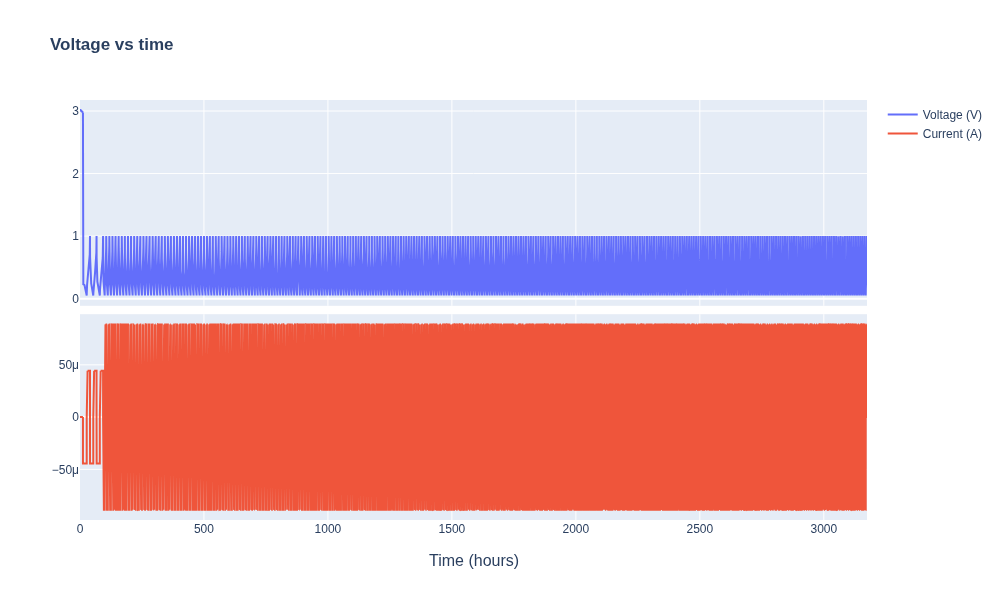
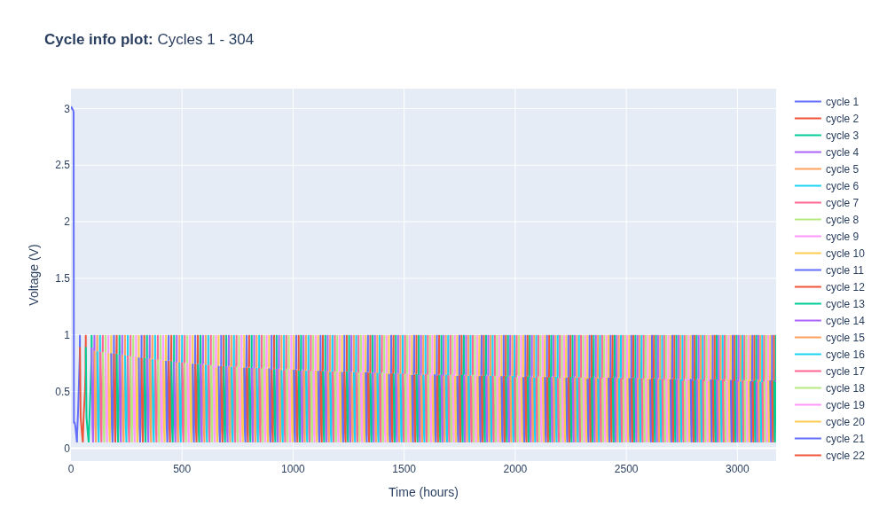
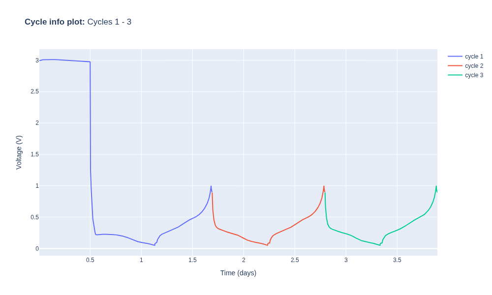
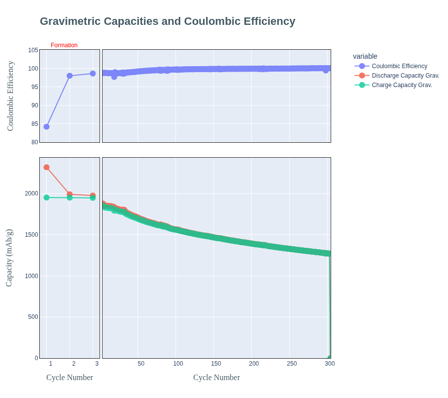
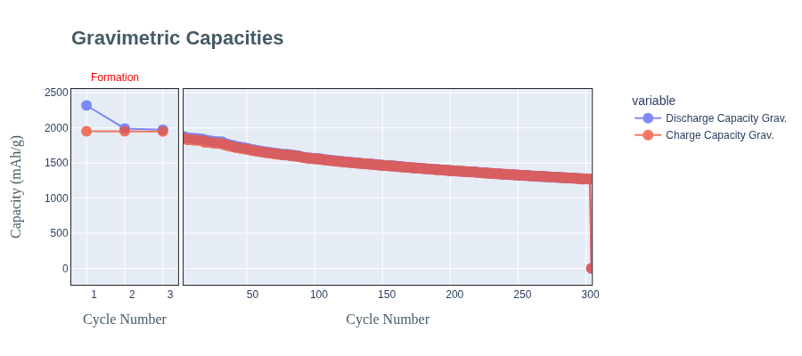
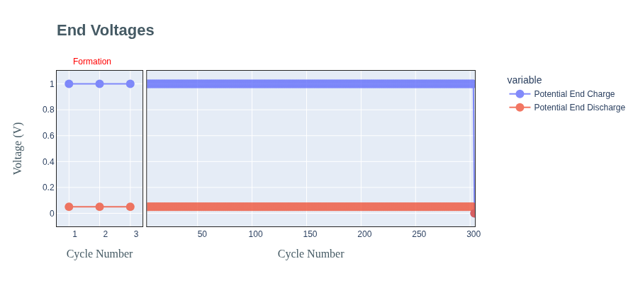

# First look at your data

!!! abstract "In this tutorial"

    You will learn how to:

    - open a saved cellpy file and check what it contains
    - plot raw traces and per-cycle information
    - draw the standard summary plots (capacity fade, efficiency)

    **Data:** the bundled example data (`cellpy.utils.example_data`), downloaded automatically.

    [:material-github: Open the notebook on GitHub](https://github.com/jepegit/cellpy/blob/master/examples/02_Initial_data_inspection.ipynb){ .md-button } — or get every notebook and its data with `cellpy pull --examples`.


```python
from rich import print

import cellpy
from cellpy.utils import example_data, plotutils

```

    WARNING:root:/home/ubuntu/.cellpy_prms_ubuntu.conf carries instrument credentials (instruments.Arbin.SQL_PWD, instruments.Arbin.SQL_UID); these are ignored — cellpy 2 reads them from the environment only (CELLPY_HOST, CELLPY_KEY_FILENAME, CELLPY_PASSWORD, CELLPY_USER).


    WARNING:root:Configured env_file /agent/repos/cellpy/.env_cellpy resolved to /agent/repos/cellpy/.env_cellpy and was not found. Create that file (or run `cellpy setup`) so those variables can be loaded.


<div class="admonition hint">
    <p class="admonition-title">Hint</p>
    <p>
    If you have <code class="docutils literal notranslate"><span class="pre">plotly</span></code> installed, some of the functions will produce interactive plots. If not, the output will be simpler <code class="docutils literal notranslate"><span class="pre">matplotlib</span></code> figures. If you have not installed <code class="docutils literal notranslate"><span class="pre">plotly</span></code>, you can do so by running <code class="docutils literal notranslate"><span class="pre">pip install plotly</span></code>.
    </p>
</div>

Load the bundled example cell. The first call downloads it if you do not already have it.

To open a file you saved in the previous tutorial instead, use `cellpy.get("out/example.cellpy")`.


```python
c = example_data.cellpy_file()

```

## Looking at the data
Your **CellpyCell** object (here called `c`) contains all your raw data as well as some additional elements, in the format of pandas DataFrames:

- **Raw data**: `c.data.raw`, raw data from the run (with units `c.data.raw_units`)
- **Summary**: `c.data.summary` with cycle-based summaries
- **Steps**: `c.data.steps` with Stats from each step (and step type), created using the `c.make_step_table` method


```python
c.data.raw.head(2)
```


<div class="cellpy-dataframe">
<table border="1" class="dataframe">
  <thead>
    <tr style="text-align: right;">
      <th></th>
      <th>test_id</th>
      <th>datapoint_num</th>
      <th>test_time</th>
      <th>step_time</th>
      <th>date_time</th>
      <th>step_num</th>
      <th>cycle_num</th>
      <th>is_fc_data</th>
      <th>current</th>
      <th>potential</th>
      <th>cumulative_charge_capacity</th>
      <th>cumulative_discharge_capacity</th>
      <th>cumulative_charge_energy</th>
      <th>cumulative_discharge_energy</th>
      <th>dv_dt</th>
      <th>internal_resistance</th>
      <th>ac_impedance</th>
      <th>aci_phase_angle</th>
    </tr>
  </thead>
  <tbody>
    <tr>
      <th>0</th>
      <td>1</td>
      <td>1</td>
      <td>300.001240</td>
      <td>299.951256</td>
      <td>2018-04-18 19:26:45</td>
      <td>1</td>
      <td>1</td>
      <td>0</td>
      <td>0.0</td>
      <td>2.992973</td>
      <td>0.0</td>
      <td>0.0</td>
      <td>0.0</td>
      <td>0.0</td>
      <td>0.000062</td>
      <td>0.0</td>
      <td>0.0</td>
      <td>0.0</td>
    </tr>
    <tr>
      <th>1</th>
      <td>1</td>
      <td>2</td>
      <td>600.014549</td>
      <td>599.964565</td>
      <td>2018-04-18 19:31:45</td>
      <td>1</td>
      <td>1</td>
      <td>0</td>
      <td>0.0</td>
      <td>2.995125</td>
      <td>0.0</td>
      <td>0.0</td>
      <td>0.0</td>
      <td>0.0</td>
      <td>0.000000</td>
      <td>0.0</td>
      <td>0.0</td>
      <td>0.0</td>
    </tr>
  </tbody>
</table>
</div>


```python
c.data.summary.head(2)
```


<div class="cellpy-dataframe">
<table border="1" class="dataframe">
  <thead>
    <tr style="text-align: right;">
      <th></th>
      <th>cycle_num</th>
      <th>datapoint_num_last</th>
      <th>last_test_time</th>
      <th>date_time</th>
      <th>ir_charge</th>
      <th>ir_discharge</th>
      <th>potential_end_charge</th>
      <th>potential_end_discharge</th>
      <th>charge_capacity</th>
      <th>discharge_capacity</th>
      <th>...</th>
      <th>test_cumulated_discharge_capacity_areal</th>
      <th>coulombic_difference_areal</th>
      <th>test_cumulated_coulombic_difference_areal</th>
      <th>discharge_capacity_loss_areal</th>
      <th>charge_capacity_loss_areal</th>
      <th>test_cumulated_discharge_capacity_loss_areal</th>
      <th>test_cumulated_charge_capacity_loss_areal</th>
      <th>shifted_charge_capacity_areal</th>
      <th>shifted_discharge_capacity_areal</th>
      <th>test_id</th>
    </tr>
  </thead>
  <tbody>
    <tr>
      <th>0</th>
      <td>1</td>
      <td>1524</td>
      <td>146226.606724</td>
      <td>2018-04-20 11:58:56.000000</td>
      <td>55.772354</td>
      <td>58.474312</td>
      <td>1.000125</td>
      <td>0.049979</td>
      <td>0.000564</td>
      <td>0.000670</td>
      <td>...</td>
      <td>0.379345</td>
      <td>0.060044</td>
      <td>0.060044</td>
      <td>NaN</td>
      <td>NaN</td>
      <td>NaN</td>
      <td>NaN</td>
      <td>0.060044</td>
      <td>0.439390</td>
      <td>0</td>
    </tr>
    <tr>
      <th>1</th>
      <td>2</td>
      <td>2464</td>
      <td>241504.322758</td>
      <td>2018-04-21 14:26:56.999999</td>
      <td>49.123096</td>
      <td>27.863733</td>
      <td>1.000125</td>
      <td>0.049979</td>
      <td>0.000564</td>
      <td>0.000575</td>
      <td>...</td>
      <td>0.704955</td>
      <td>0.006520</td>
      <td>0.066564</td>
      <td>0.053736</td>
      <td>0.000211</td>
      <td>0.053736</td>
      <td>0.000211</td>
      <td>0.066564</td>
      <td>0.392174</td>
      <td>0</td>
    </tr>
  </tbody>
</table>
<p>2 rows × 53 columns</p>
</div>


```python
c.data.steps.head(2)
```


<div class="cellpy-dataframe">
<table border="1" class="dataframe">
  <thead>
    <tr style="text-align: right;">
      <th></th>
      <th>index</th>
      <th>cycle_num</th>
      <th>step_num</th>
      <th>sub_step_num</th>
      <th>datapoint_num_mean</th>
      <th>datapoint_num_std</th>
      <th>datapoint_num_min</th>
      <th>datapoint_num_max</th>
      <th>datapoint_num_first</th>
      <th>datapoint_num_last</th>
      <th>...</th>
      <th>internal_resistance_min</th>
      <th>internal_resistance_max</th>
      <th>internal_resistance_first</th>
      <th>internal_resistance_last</th>
      <th>internal_resistance_delta</th>
      <th>c_rate</th>
      <th>step_type</th>
      <th>sub_step_type</th>
      <th>info</th>
      <th>test_id</th>
    </tr>
  </thead>
  <tbody>
    <tr>
      <th>0</th>
      <td>0</td>
      <td>1</td>
      <td>1</td>
      <td>1</td>
      <td>72.5</td>
      <td>41.713307</td>
      <td>1</td>
      <td>144</td>
      <td>1</td>
      <td>144</td>
      <td>...</td>
      <td>0.000000</td>
      <td>0.000000</td>
      <td>0.000000</td>
      <td>0.000000</td>
      <td>0.0</td>
      <td>0.00000</td>
      <td>rest</td>
      <td>NaN</td>
      <td></td>
      <td>0</td>
    </tr>
    <tr>
      <th>1</th>
      <td>1</td>
      <td>1</td>
      <td>2</td>
      <td>1</td>
      <td>145.0</td>
      <td>NaN</td>
      <td>145</td>
      <td>145</td>
      <td>145</td>
      <td>145</td>
      <td>...</td>
      <td>58.474312</td>
      <td>58.474312</td>
      <td>58.474312</td>
      <td>58.474312</td>
      <td>0.0</td>
      <td>0.00009</td>
      <td>ir</td>
      <td>NaN</td>
      <td></td>
      <td>0</td>
    </tr>
  </tbody>
</table>
<p>2 rows × 65 columns</p>
</div>


## Simple plotting

The `plotutils` module contains several convenient plot functions:

### Raw plots

The `raw_plot` gives an overview of your datacollection, plotting voltage vs time:


```python
plotutils.raw_plot(c, title="Voltage vs time")
```


    

    


### Cycle info plots

The `cycle_info_plot` function plots the raw data together with step and cycle info:


```python
plotutils.cycle_info_plot(c, title="Cycle info plot:")
```


    

    


These plot functions offer some flexibility. You can, e.g. select specific cycles to look at, or adjust the units of the plot variables:


```python
cycles = list(c.get_cycle_numbers())[:3]
plotutils.cycle_info_plot(c, cycle=cycles, title="Cycle info plot:", t_unit="days")

```


    

    


## Summary plots

`summary_plots` allows you to plot different summary variables. You can inspect the columns of `c.data.summary` to check what variables are available.


```python
print(c.data.summary.columns)
```

    Index(['cycle_num', 'datapoint_num_last', 'last_test_time', 'date_time',
           'ir_charge', 'ir_discharge', 'potential_end_charge',
           'potential_end_discharge', 'charge_capacity', 'discharge_capacity',
           'coulombic_efficiency', 'cumulated_coulombic_efficiency',
           'test_cumulated_charge_capacity', 'test_cumulated_discharge_capacity',
           'discharge_capacity_loss', 'charge_capacity_loss',
           'coulombic_difference', 'test_cumulated_coulombic_difference',
           'test_cumulated_discharge_capacity_loss',
           'test_cumulated_charge_capacity_loss', 'shifted_charge_capacity',
           'shifted_discharge_capacity', 'cumulated_ric', 'cumulated_ric_sei',
           'cumulated_ric_disconnect', 'normalized_cycle_index', 'charge_c_rate',
           'discharge_c_rate', 'discharge_capacity_gravimetric',
           'charge_capacity_gravimetric',
           'test_cumulated_charge_capacity_gravimetric',
           'test_cumulated_discharge_capacity_gravimetric',
           'coulombic_difference_gravimetric',
           'test_cumulated_coulombic_difference_gravimetric',
           'discharge_capacity_loss_gravimetric',
           'charge_capacity_loss_gravimetric',
           'test_cumulated_discharge_capacity_loss_gravimetric',
           'test_cumulated_charge_capacity_loss_gravimetric',
           'shifted_charge_capacity_gravimetric',
           'shifted_discharge_capacity_gravimetric', 'discharge_capacity_areal',
           'charge_capacity_areal', 'test_cumulated_charge_capacity_areal',
           'test_cumulated_discharge_capacity_areal', 'coulombic_difference_areal',
           'test_cumulated_coulombic_difference_areal',
           'discharge_capacity_loss_areal', 'charge_capacity_loss_areal',
           'test_cumulated_discharge_capacity_loss_areal',
           'test_cumulated_charge_capacity_loss_areal',
           'shifted_charge_capacity_areal', 'shifted_discharge_capacity_areal',
           'test_id'],
          dtype='str')


Here is one example:


```python
plotutils.summary_plot(
    c,
    y="capacities_gravimetric_coulombic_efficiency",
    title="<b>Gravimetric Capacities and Coulombic Efficiency</b>",
)

```


    

    


The `summary_plot` function also have some pre-defined sets of variables for plotting the most common variables.


```python
plotutils.summary_plot(
    c, y="capacities_gravimetric", title="<b>Gravimetric Capacities</b>"
)
```


    

    


```python
plotutils.summary_plot(c, y="voltages", title="<b>End Voltages</b>")
```


    

    


The `summary_plot` function also has some pre-defined sets of variables for plotting the most common variables.

The pre-defined variable sets for the summary plots are:

- `"voltages"`
- `"capacities"`
- `"capacities_gravimetric"` / `"capacities_areal"` / `"capacities_absolute"`
- `"capacities_gravimetric_coulombic_efficiency"` / `"capacities_areal_coulombic_efficiency"` / `"capacities_absolute_coulombic_efficiency"`
- `"capacities_gravimetric_with_rate"` / `"capacities_areal_with_rate"` / `"capacities_absolute_with_rate"`
- `"capacities_gravimetric_split_constant_voltage"` / `"capacities_areal_split_constant_voltage"`
- `"fullcell_standard_gravimetric"` / `"fullcell_standard_areal"` / `"fullcell_standard_absolute"`
- `"fullcell_standard_cumloss_gravimetric"` / `"fullcell_standard_cumloss_areal"` / `"fullcell_standard_cumloss_absolute"`
- `"fullcell_standard_dev"`

